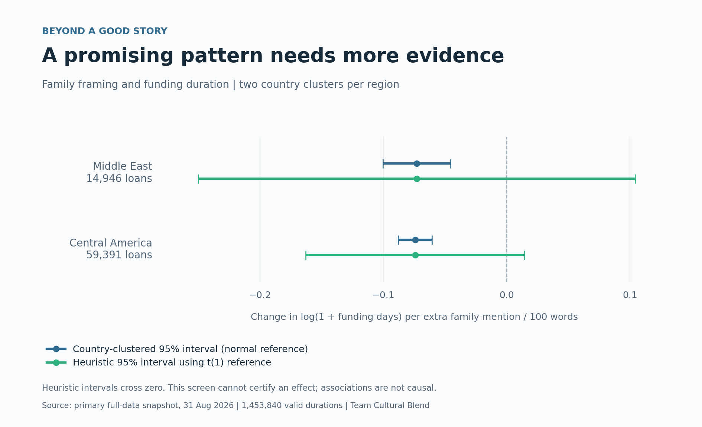

# Cultural Blend — Kiva funding-speed research

**Finalist, UNSW Marketing Analytics Hackathon Challenge 2026.** Cultural
Blend (Sophia and Tuan) was one of eight finalist teams selected from 44
registered teams involving 133 students at 19 universities across eight
countries. The final took place on 4 September 2026.
[Official UNSW results](https://www.unsw.edu.au/business/our-schools/marketing/news-events/student-events/MA-hackathon).

## Problem and data

Which narrative choices in Kiva loan descriptions are associated with faster
funding, and how do those patterns differ across contexts and periods?
The project analysed **1,453,846 loan records from 2016–2025**. Six negative
durations were excluded, leaving **1,453,840 valid completed durations**,
including 1,637 refunded records. Outcomes were time from fundraising to
completed funding and completion within 24 hours. The analysis does not
estimate whether all listed loans will eventually fund.

## Approach

The team combined deterministic text features, sentiment and topic features
with loan, borrower, geography and time variables. The tested Python pipeline
used explanatory duration OLS and a binomial GLM, compared HC3 uncertainty
with country-clustered uncertainty, and estimated average within-region
family-framing contrasts. Separate predictive models used a chronological
2024–2025 holdout, fitting preprocessing and learned text transformations on
earlier loans only. The [primary reports and provenance](../reports/generated_full_dataset/)
retain the verified saved run; the primary metrics below come from that
snapshot. Later maintenance extensions are identified separately.

## Findings and practical interpretation

- **Predictive patterns were measurable:** on 278,887 holdout loans, the
  nonlinear duration benchmark achieved MAE **5.20 days** and R² **0.542**;
  the 24-hour classifier achieved **0.900 ROC AUC** and **0.830 average
  precision**. Training used 1,174,953 loans. These are prediction metrics,
  not causal estimates of narrative effectiveness.
- **Uncertainty mattered more than a compelling story:** apparent urgency
  associations under HC3 were not supported under country clustering.
  Regional family-framing patterns were descriptive because each focal
  region had only two country clusters. These results do not establish that
  narrative choices have no effect.
- **The outcome needed careful interpretation:** widespread pre-disbursal
  means platform funding duration often follows an earlier disbursal. Faster
  platform funding cannot simply be described as less waiting for borrowers.

The practical contribution is a reproducible way to test narrative claims,
check their uncertainty and identify what additional evidence would be needed
before recommending a writing strategy. The observational evidence alone
does not justify a universal narrative intervention.

The same point estimates can look more conclusive than their evidence permits.
Both regional patterns depend on only two country clusters. This exhibit is
built directly from the saved primary report; the wider intervals are a
heuristic sensitivity screen, not a calibrated correction.

## Limits and maintained research record

Country dependence, sparse regional clusters, omitted partner information,
programme differences and selection into completed-funding records restrict
interpretation. Feature importance cannot identify a causal mechanism.
The self-contained modeling notebook and expanded feature sensitivity use
different specifications. The [reviewed maintenance extension](../reports/expanded_feature_sensitivity_reviewed/README.md)
adds programme-text controls and numerical safeguards, while preserving a
rejected diagnostic run and the recovered historical snapshot. These later
checks do not replace the primary pipeline or the submitted project record. See [evidence and corrections](2_evidence_and_corrections.md)
for precise qualifications and links to the historical record.

The October maintenance reran explanatory sensitivity on the full input and
showed that statistical support changes with programme controls. It also
caught and corrected an absorbed-predictor defect before accepting the results.
These later checks strengthen the research record; they are separate from the
September competition submission and its original predictive metrics.

## LinkedIn achievement entry

**Title:** Finalist — UNSW Marketing Analytics Hackathon Challenge 2026

**Organisation:** UNSW Business School

**Date:** September 2026

Selected as one of eight finalist teams from 44 registered teams in the UNSW
Marketing Analytics Hackathon Challenge 2026. As part of Cultural Blend with
Sophia, analysed 1.45 million Kiva loan records to investigate associations
between loan narratives and funding speed. Our work combined text analysis,
statistical inference, chronological predictive validation and sensitivity
checks, with an emphasis on reproducibility and responsible interpretation.

This is an achievement description for Tuan's profile; it does not assign an
unverified individual contribution split or describe finalist recognition as
a prize win. [Official recognition](https://www.unsw.edu.au/business/our-schools/marketing/news-events/student-events/MA-hackathon).
